<div align="center">


# SoundSense

**A personal music player for Android and PC.**<br>
SoundCloud, YouTube Music, Yandex Music and local files in one library.


🇬🇧 English · [🇷🇺 Русский](README.md)

[Download](#install) · [Plugins](#plugins) · [Development](#development) · [Docs](docs/)

</div>

<p align="center">
  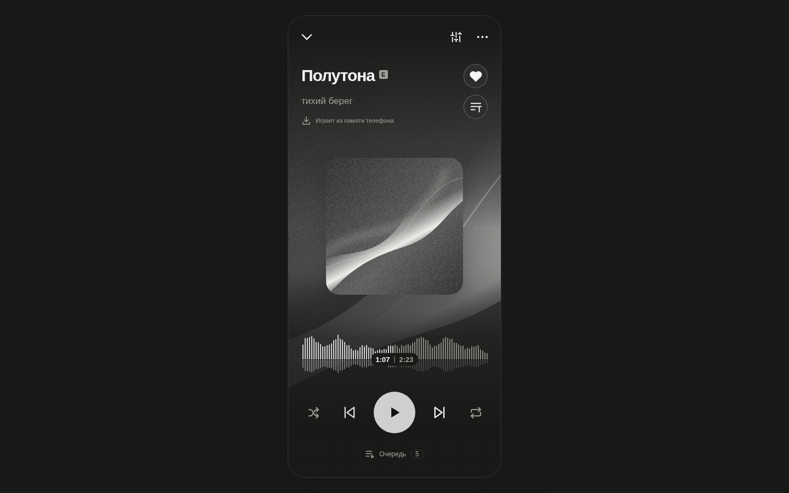
</p>

## Features

- **One library for every source.** Likes, playlists and history are shared. If a track disappears from one service, the player finds it in another.
- **Import by link** from SoundCloud, YouTube Music and Yandex Music. Large lists load in batches, and a repeated import adds only new tracks.
- **Smooth crossfade** between tracks (0–12 s), loudness normalization, resume where you stopped.
- **Sound:** speed and pitch, Slowed + Reverb and Nightcore presets, reverb, 10-band equalizer.
- **A waveform instead of a progress bar.** Computed on the device as a stream, tap to seek.
- **Lyrics** with line highlighting and word-by-word sweep, your own text and `.lrc` files.
- **Offline:** download tracks, playlists and likes, with a separate cache for listened tracks.
- **PC ↔ phone sync** directly between devices, no server of your own; the data is encrypted.
- **Three independent appearance axes:** style, colors (including colors from the cover) and animations.
- **Plugins** with clear permissions and a catalog inside the app.
- **No telemetry, no ads.** Tokens live in the system's secure storage.

## Screenshots

### Desktop

<table>
  <tr>
    <td>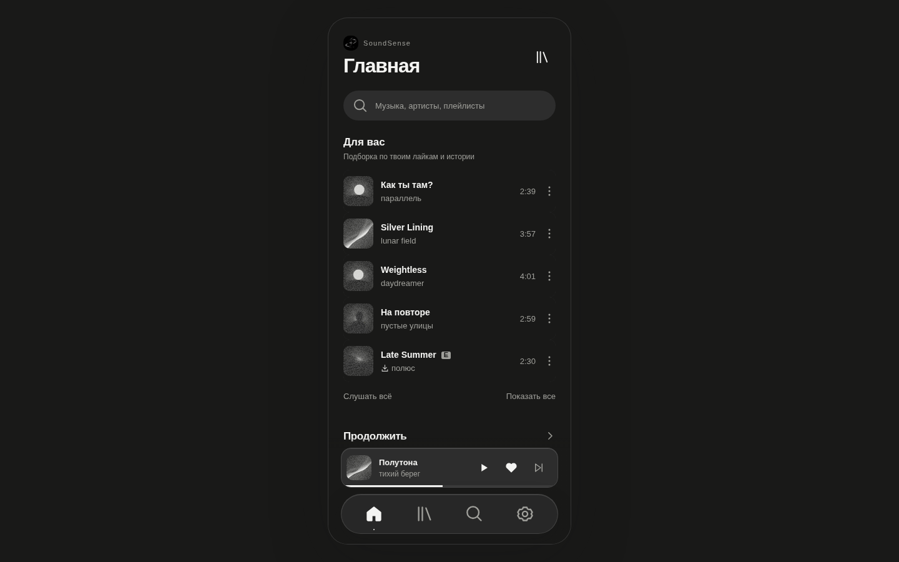</td>
    <td>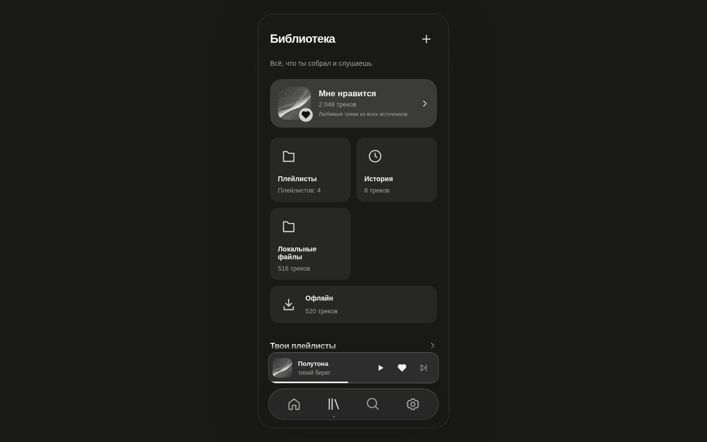</td>
  </tr>
  <tr>
    <td>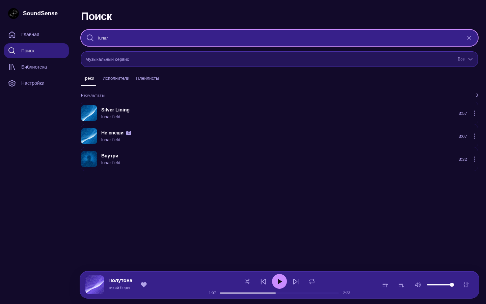</td>
    <td>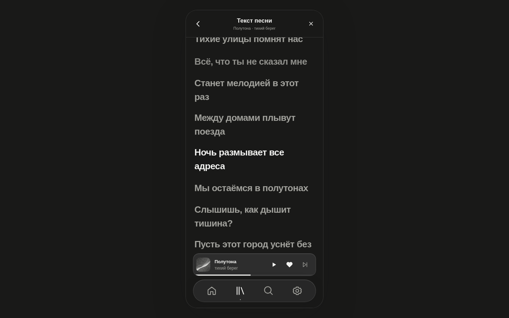</td>
  </tr>
  <tr>
    <td>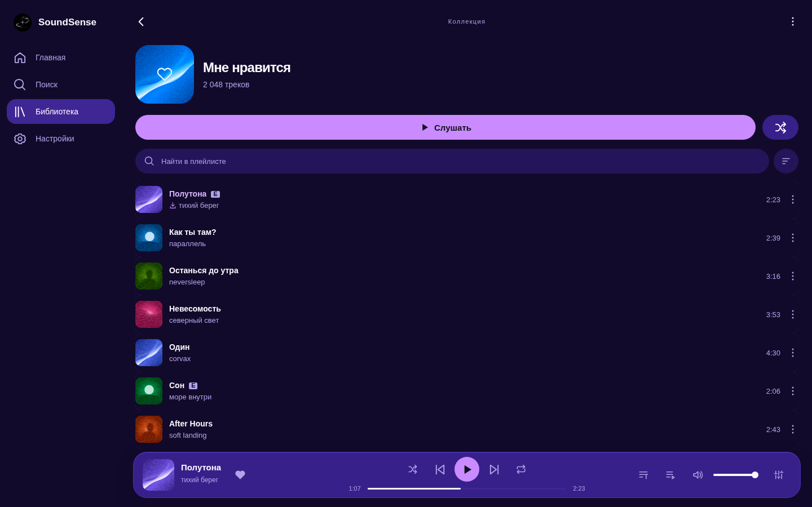</td>
    <td>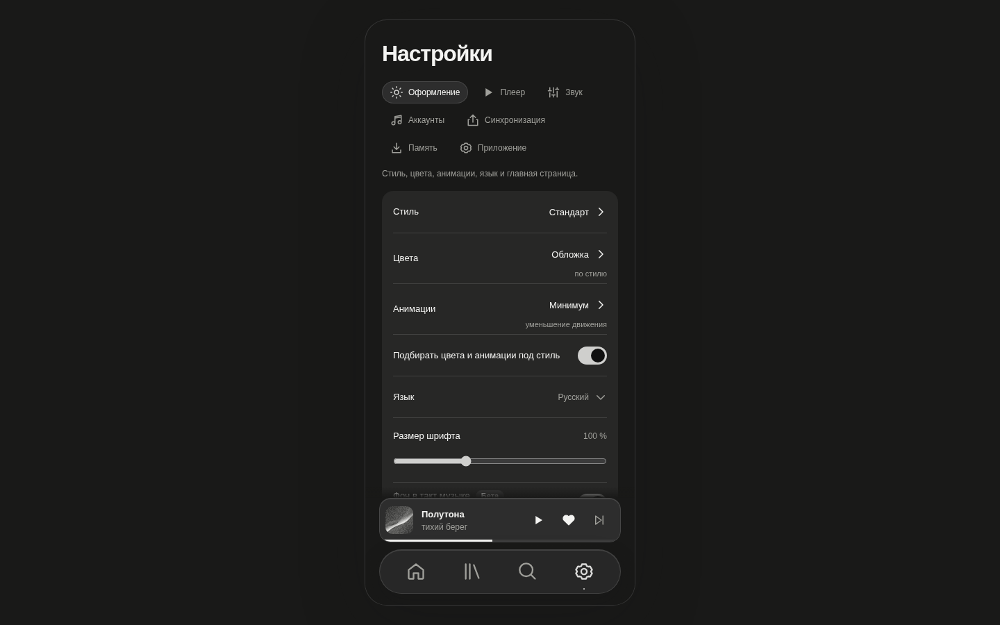</td>
  </tr>
</table>

### Phone

<p align="center">
  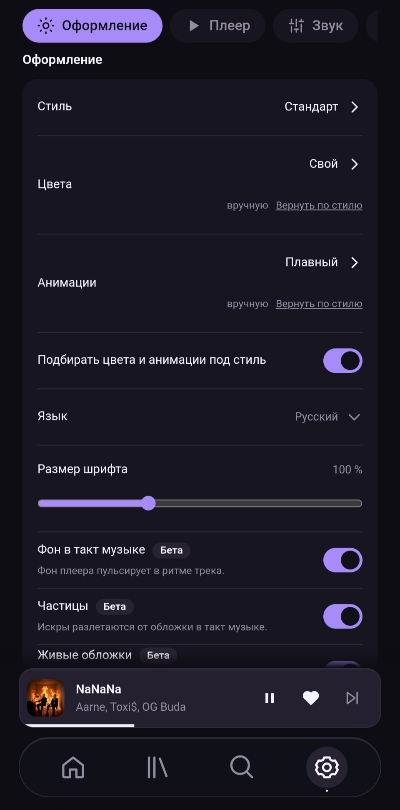
  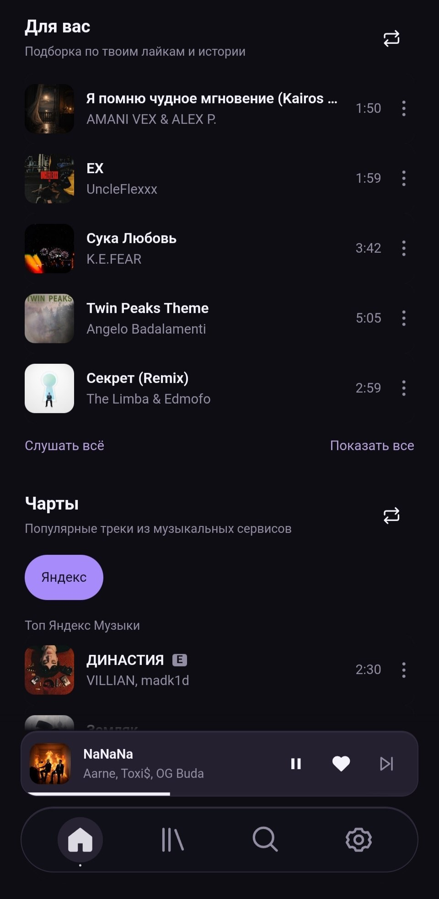
  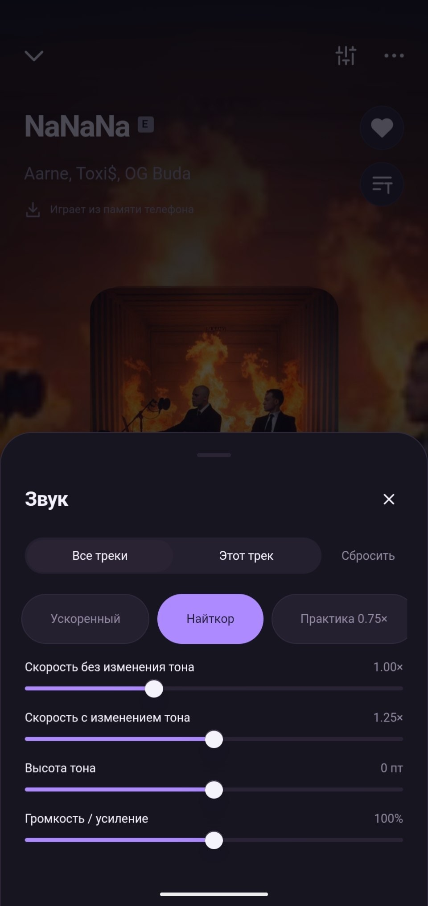
  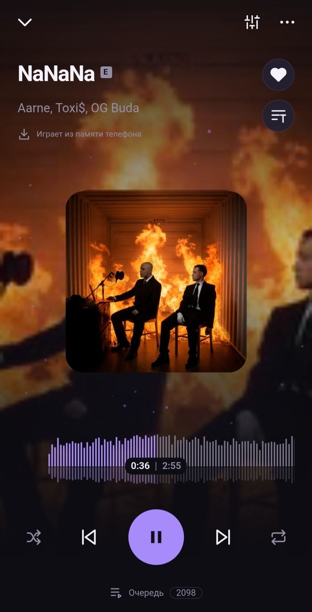
  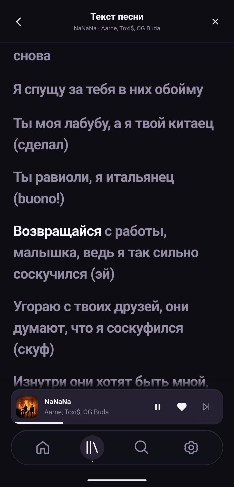
</p>

## Install

Ready-made builds live in the [`releases`](../../tree/releases) branch: `SoundSense-<version>-stable.apk` and `SoundSense-<version>-beta.apk`.

| Channel | For whom |
|---|---|
| **stable** | everyday use |
| **beta** | new features first, plugins, log and diagnostic tools |

The channels can be installed side by side: each has its own library and settings. The first APK is installed by hand (Android will ask you to allow installs from the source); after that the app updates itself.

### Updates

The app watches the `releases` branch. If it holds a version newer than the installed one, the app offers to download it. Before installing, it checks the Ed25519 signature, SHA-256, size, package ID and certificate; it will not accept an older version. Checks run on their own, at launch and on a timer.

## Plugins

A plugin runs in an isolated Worker and sees only what the user allows. The catalog of reviewed plugins is in [`plugins/`](plugins/). In the app: **Plugins → Plugin catalog → Get**.

| Plugin | What it does |
|---|---|
| **Now Playing in Discord** | posts the current track to a Discord channel through a webhook |
| **ListenBrainz scrobbler** | records your listens in ListenBrainz |
| **Sleep timer** | pauses after 15–60 minutes or after the track |
| **Play counter** | top tracks, an example of the API |
| **lyrics.ovh** | an extra lyrics source |

Your own plugin: a folder in `plugins/src/` with `manifest.json` (name and description are required), `main.js` and an icon, then `npm run plugin:catalog`. The API and permissions are described in [docs/PLUGINS.md](docs/PLUGINS.md) (Russian).

## Development

Node.js 20.18+ and npm are required.

```sh
npm ci
npm run dev            # http://127.0.0.1:5173, in beta add /?demo=1 for the demo library
npm run check          # Svelte and TypeScript types
npm run lint           # colors only from appearance packs, layer boundaries
npm test               # unit tests
npm run test:ui        # browser tests (Playwright)
```

```sh
npm run desktop                 # Electron in development mode
npm run desktop:appimage        # AppImage in artifacts/desktop/
npm run android:setup           # once: SDK and JDK in .toolchain/
npm run android:apk:beta        # APK in artifacts/android/beta/
npm run plugin:catalog          # rebuild the plugin catalog
```

Releasing (checks, APK, signing, publishing to the `releases` branch): `npm run release:beta` or `npm run release:stable`, see [docs/RELEASES.md](docs/RELEASES.md) (Russian).

### Structure

```text
src/core/        core: sources, library, queue, sync, updates, plugins
src/platform/    browser, Android and Electron adapters
src/ui/          Svelte interface (shared by PC and phone)
android/         Capacitor and native Kotlin/Java parts
desktop/         Electron shell
plugins/         plugin catalog: src/, packages/, catalog.json
scripts/         build, checks, releases
tests/           unit, UI, channels, performance
docs/            spec, appearance, plugins, releases, changes
```

## Community

- Channel: [@OpenSoundSense](https://t.me/OpenSoundSense)
- Forum: [@SoundSenseForum](https://t.me/SoundSenseForum)

## Documentation

Most documents are in Russian.

- [Spec and principles](docs/SPEC.md)
- [Appearance: style, colors, animations](docs/APPEARANCE.md)
- [Plugins and catalog](docs/PLUGINS.md)
- [Releases and updates](docs/RELEASES.md)
- [Changelog](docs/CHANGELOG.md)
- [About the repository](docs/REPOSITORY.md)
- [Telegram bot for the channel and forum](tools/telegram/README.md)
