<div align="center">

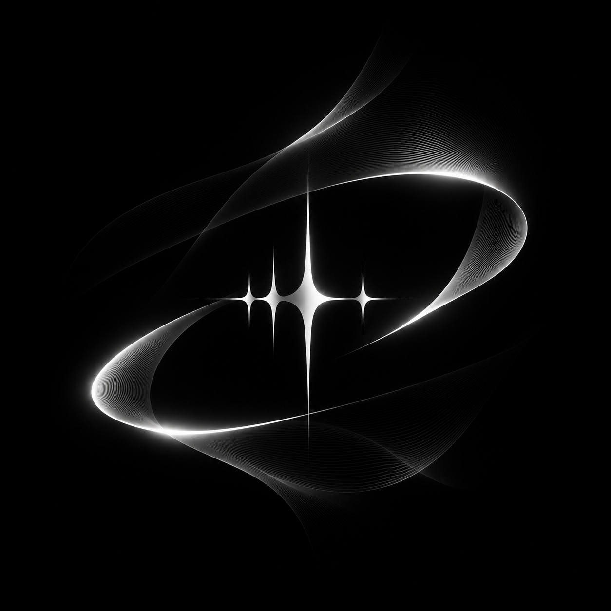

# SoundSense

**Личный музыкальный плеер для Android и ПК.**<br>
SoundCloud, YouTube Music, Яндекс Музыка и локальные файлы в одной библиотеке.


🇷🇺 Русский · [🇬🇧 English](README.en.md)

[Скачать](#установка) · [Плагины](#плагины) · [Разработка](#разработка) · [Документация](docs/)

</div>

<p align="center">
  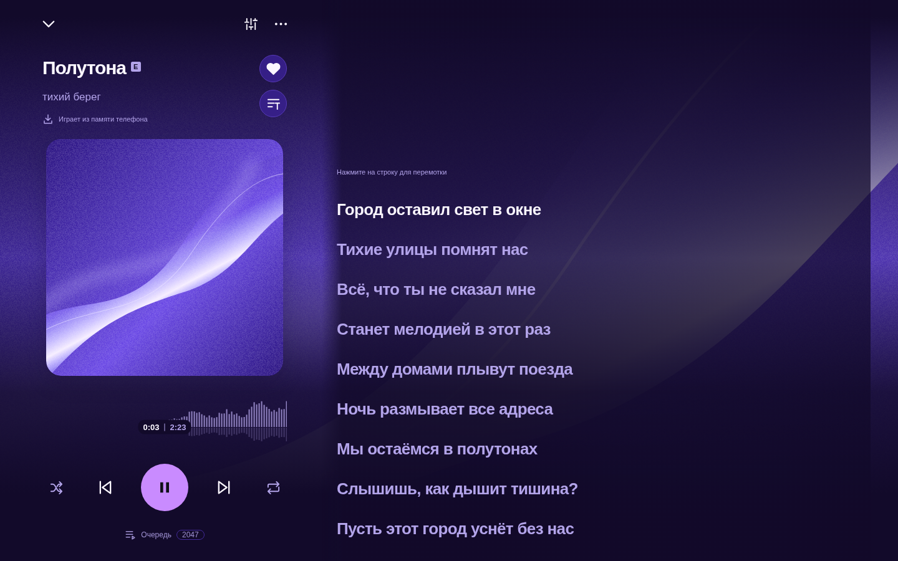
</p>

## Возможности

- **Одна библиотека для всех источников.** Лайки, плейлисты и история общие. Если трек пропал в одном сервисе, плеер найдёт его в другом.
- **Импорт по ссылке** из SoundCloud, YouTube Music и Яндекс Музыки; большие списки грузятся пачками. Повторный импорт добавляет только новое.
- **Плавные переходы** между треками (0–12 с), выравнивание громкости, продолжение с того же места.
- **Звук:** скорость и тон, пресеты Slowed + Reverb и Nightcore, реверб, 10-полосный эквалайзер.
- **Волна вместо прогресс-бара.** Считается на устройстве потоково, перемотка касанием.
- **Тексты песен** с подсветкой строк и слов в такт, свой текст и `.lrc`.
- **Офлайн:** скачивание треков, плейлистов и лайков, отдельный кэш прослушанного.
- **Синхронизация ПК и телефона** напрямую между устройствами, без своего сервера; данные шифруются.
- **Оформление из трёх независимых частей:** стиль, цвета (в том числе по обложке) и анимации.
- **Плагины** с понятными разрешениями и каталогом прямо в приложении.
- **Без телеметрии и рекламы.** Токены хранятся в защищённом хранилище системы.

## Скриншоты

### ПК

<table>
  <tr>
    <td>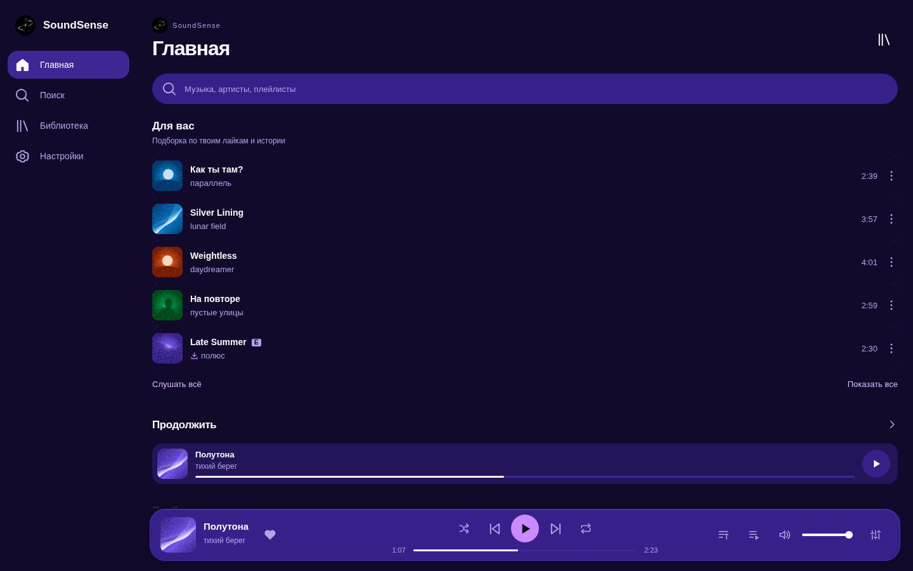</td>
    <td>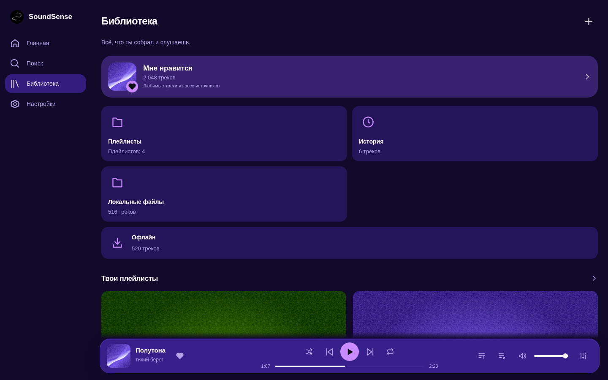</td>
  </tr>
  <tr>
    <td>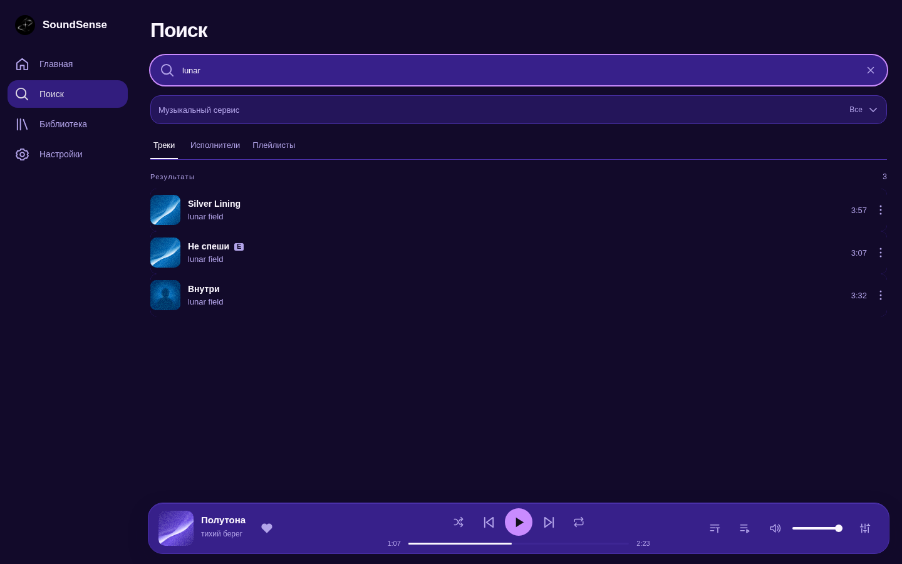</td>
    <td>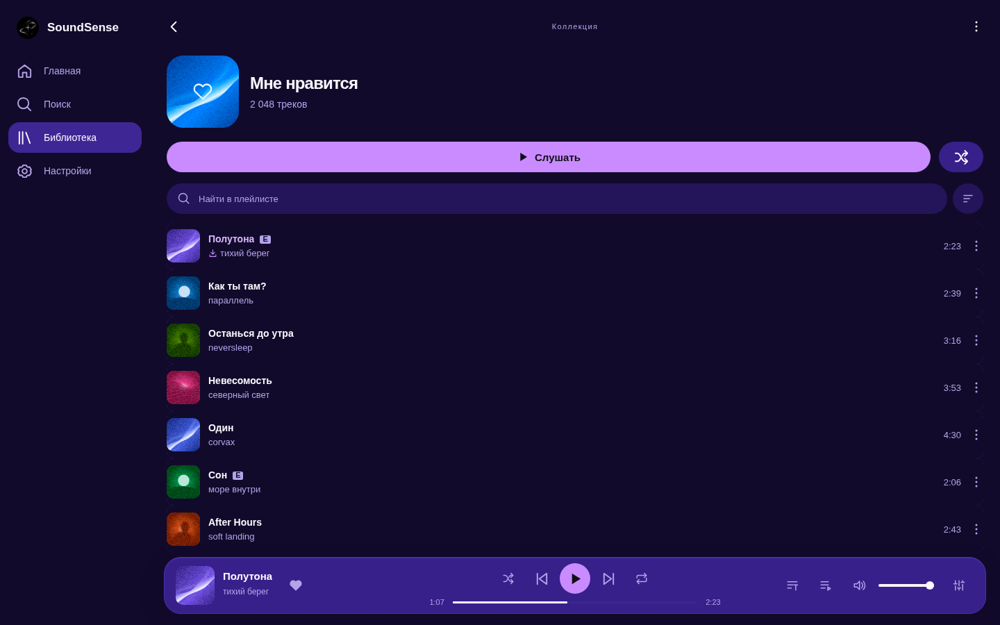</td>
  </tr>
  <tr>
    <td>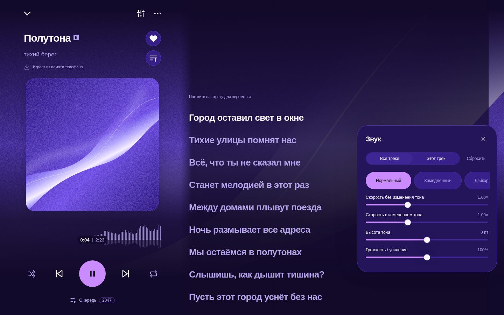</td>
    <td>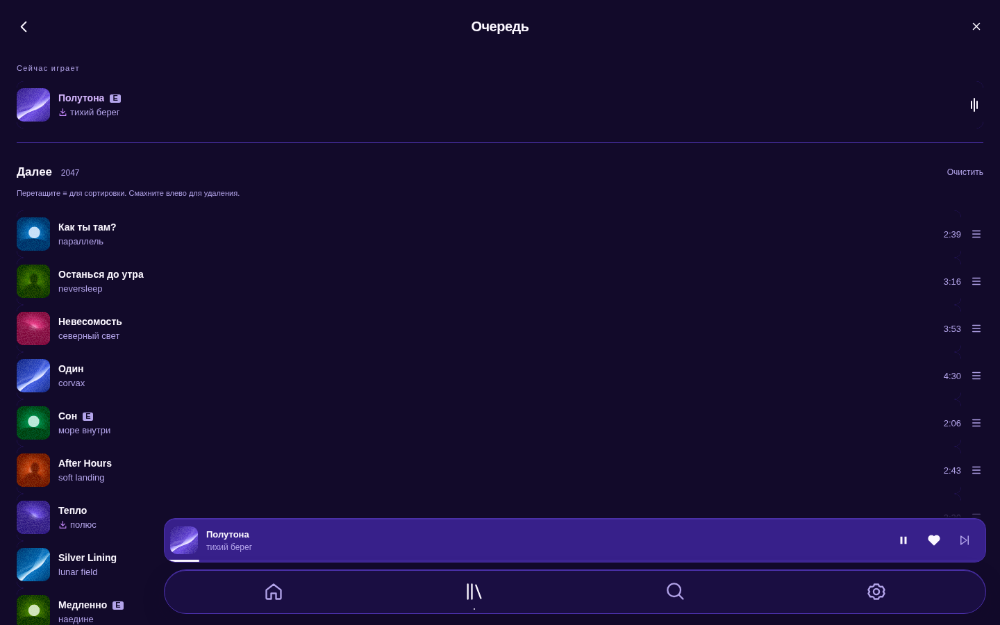</td>
  </tr>
  <tr>
    <td>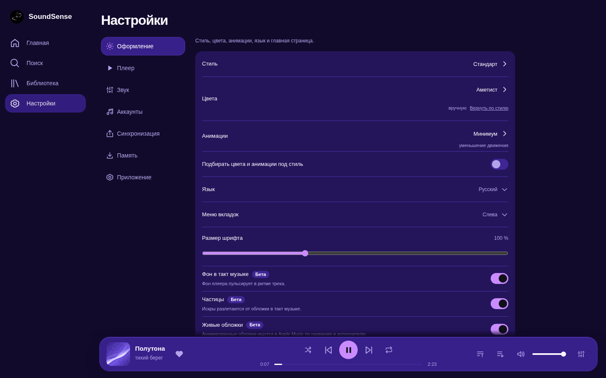</td>
    <td>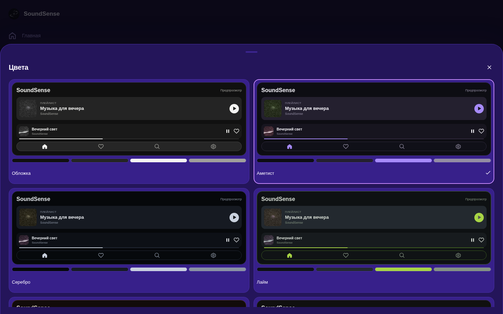</td>
  </tr>
  <tr>
    <td>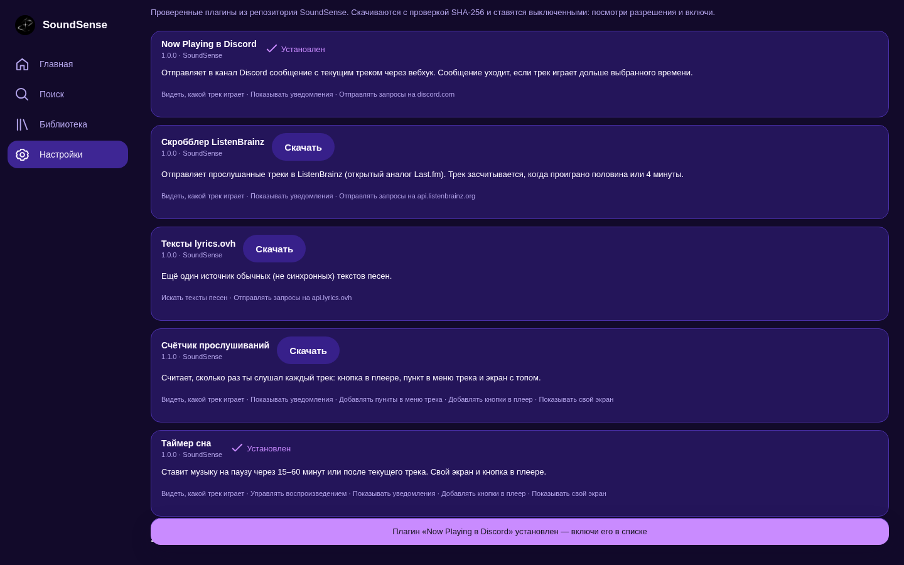</td>
    <td></td>
  </tr>
</table>

### Android

<p align="center">
  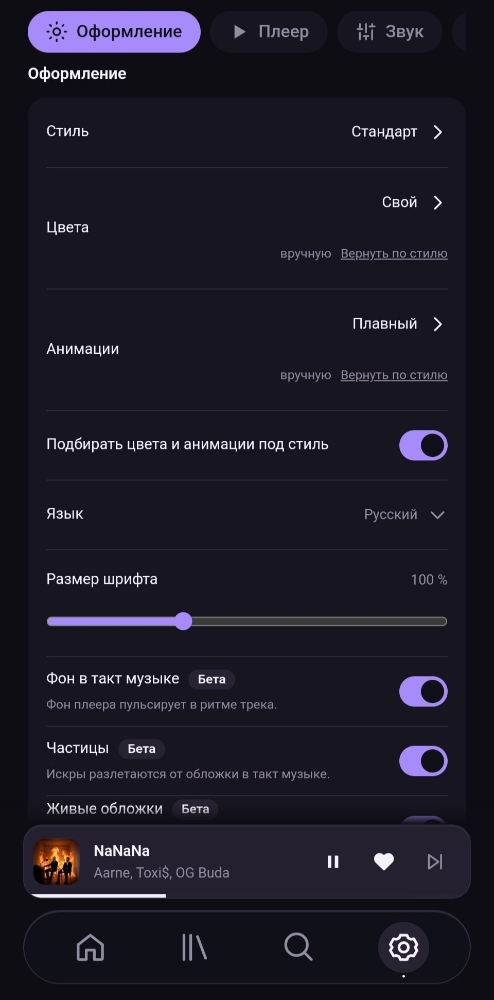
  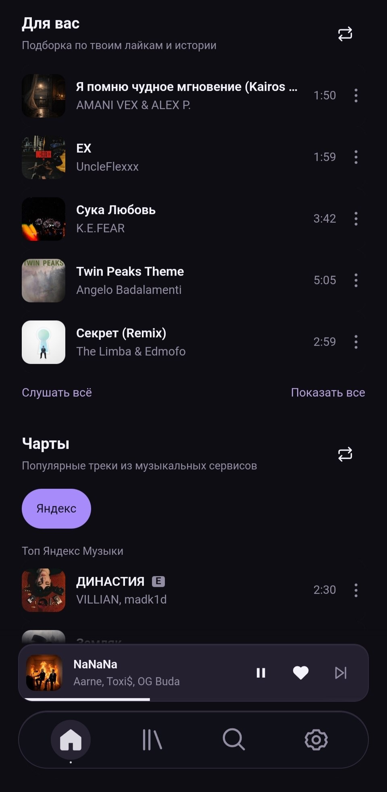
  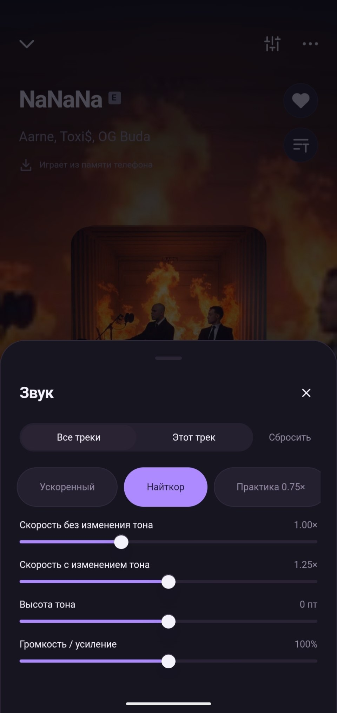
  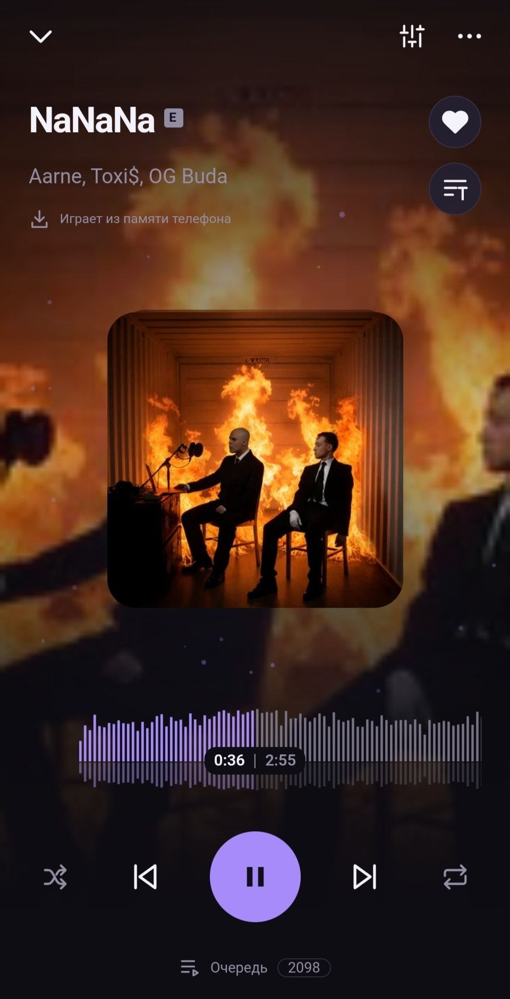
  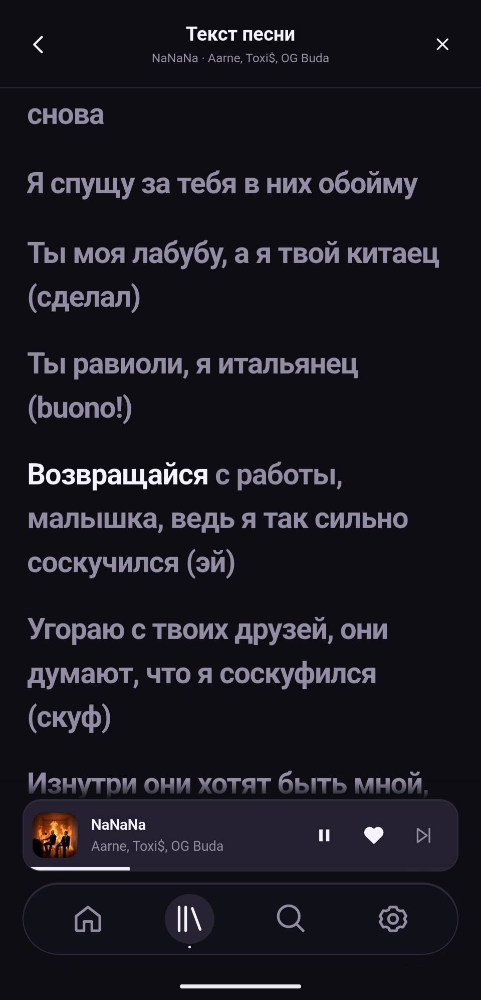
</p>

## Установка

Готовые сборки лежат в ветке [`releases`](../../tree/releases): `SoundSense-<версия>-stable.apk` и `SoundSense-<версия>-beta.apk`.

| Канал | Для кого |
|---|---|
| **stable** | обычное использование |
| **beta** | новые функции раньше, плагины, журнал и инструменты диагностики |

Каналы можно поставить рядом: у каждого своя библиотека и настройки. Первый раз APK ставится вручную (Android попросит разрешить установку из этого источника), дальше приложение обновляется само.

### Обновления

Приложение смотрит на ветку `releases`. Если там версия новее установленной, оно предложит скачать её. Перед установкой проверяются подпись Ed25519, SHA-256, размер, идентификатор и сертификат пакета; откатиться на старую версию приложение не даст. Проверка идёт сама, при запуске и по таймеру.

## Плагины

Плагин работает в изолированном Worker и видит только то, что разрешил пользователь. Каталог проверенных плагинов находится в [`plugins/`](plugins/), установка в приложении: **Плагины → Каталог плагинов → Скачать**.

| Плагин | Что делает |
|---|---|
| **Now Playing в Discord** | сообщение с текущим треком в канал Discord через вебхук |
| **Скробблер ListenBrainz** | записывает прослушивания в ListenBrainz |
| **Таймер сна** | пауза через 15–60 минут или после трека |
| **Счётчик прослушиваний** | топ треков, пример использования API |
| **lyrics.ovh** | дополнительный источник текстов |

Свой плагин: папка в `plugins/src/` с `manifest.json` (имя и описание обязательны), `main.js` и иконкой, затем `npm run plugin:catalog`. API и разрешения описаны в [docs/PLUGINS.md](docs/PLUGINS.md).

## Разработка

Нужен Node.js 20.18+ и npm.

```sh
npm ci
npm run dev            # http://127.0.0.1:5173, в beta добавьте /?demo=1 для демо-библиотеки
npm run check          # типы Svelte и TypeScript
npm run lint           # цвета только из пакетов оформления, границы слоёв
npm test               # unit-тесты
npm run test:ui        # браузерные тесты (Playwright)
```

```sh
npm run desktop                 # Electron в режиме разработки
npm run desktop:appimage        # AppImage в artifacts/desktop/
npm run android:setup           # один раз: SDK и JDK в .toolchain/
npm run android:apk:beta        # APK в artifacts/android/beta/
npm run plugin:catalog          # пересобрать каталог плагинов
```

Выпуск версии (проверки, APK, подпись, публикация в ветку `releases`): `npm run release:beta` или `npm run release:stable`, подробности в [docs/RELEASES.md](docs/RELEASES.md).

### Структура

```text
src/core/        ядро: источники, библиотека, очередь, синхронизация, обновления, плагины
src/platform/    адаптеры браузера, Android и Electron
src/ui/          интерфейс на Svelte (общий для ПК и телефона)
android/         Capacitor и нативные части на Kotlin/Java
desktop/         оболочка Electron
plugins/         каталог плагинов: src/, packages/, catalog.json
scripts/         сборка, проверки, выпуск
tests/           unit, UI, каналы, производительность
docs/            ТЗ, оформление, плагины, выпуски, изменения
```

## Сообщество

- Канал: [@OpenSoundSense](https://t.me/OpenSoundSense)
- Форум: [@SoundSenseForum](https://t.me/SoundSenseForum)

## Документация

- [ТЗ и принципы](docs/SPEC.md)
- [Оформление: стиль, цвета, анимации](docs/APPEARANCE.md)
- [Плагины и каталог](docs/PLUGINS.md)
- [Выпуски и обновления](docs/RELEASES.md)
- [Список изменений](docs/CHANGELOG.md)
- [О репозитории](docs/REPOSITORY.md)
- [Telegram-бот канала и форума](tools/telegram/README.md)
